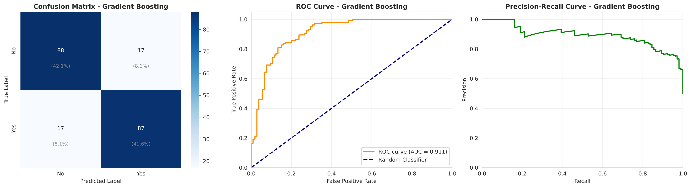
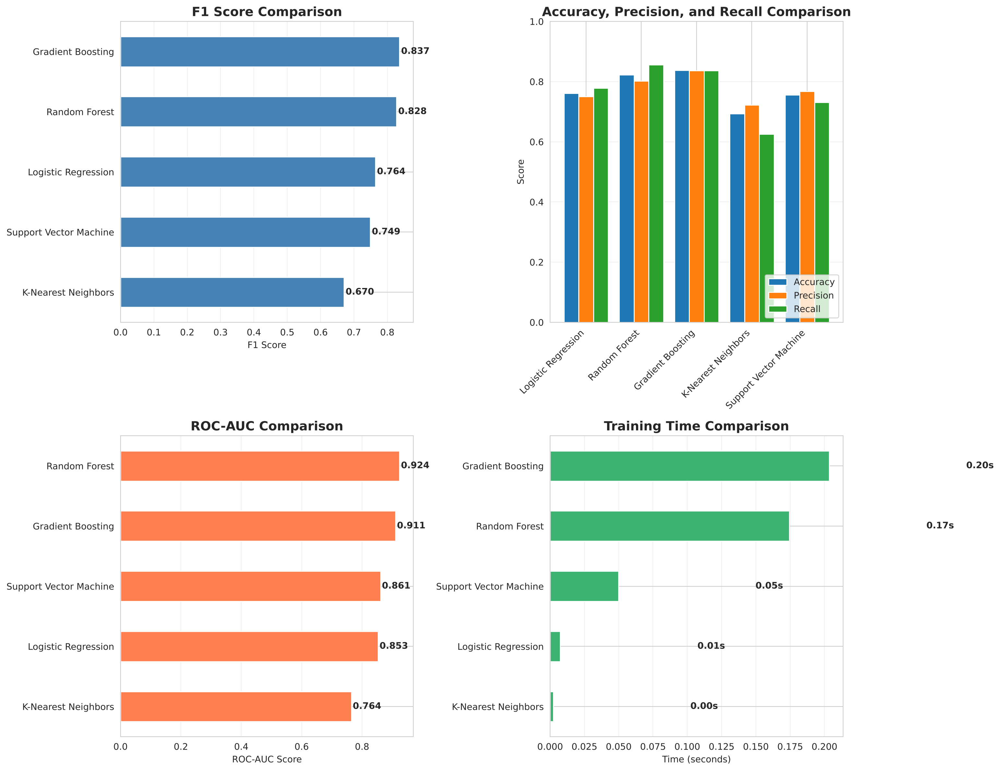

# Bank Marketing Campaign Prediction

A bank ran phone campaigns to sell term deposits, and only 11.5% of the clients it called said yes. This project predicts which clients are likely to subscribe, so a bank can call its most likely customers first instead of calling everyone.



## Results

I compared five classifiers trained on the same balanced data, tracking each run's parameters, metrics and model in MLflow.

| Model | Accuracy | Precision | Recall | F1 | ROC-AUC |
|---|---|---|---|---|---|
| **Gradient Boosting** | **0.837** | **0.837** | 0.837 | **0.837** | 0.911 |
| Random Forest | 0.823 | 0.802 | **0.856** | 0.828 | **0.924** |
| Logistic Regression | 0.761 | 0.750 | 0.779 | 0.764 | 0.853 |
| Support Vector Machine | 0.756 | 0.768 | 0.731 | 0.749 | 0.861 |
| K-Nearest Neighbors | 0.694 | 0.722 | 0.625 | 0.670 | 0.764 |

Evaluated on a held-out test set of 209 clients (see [Limitations](#limitations)).



## What I did

- **Exploratory analysis** of 4,521 client records with 16 features: demographics, account balance and loans, and campaign history. I measured how response rate varies with each one.
- **Class imbalance.** "No" outnumbers "yes" 7.7 to 1, so a model that always predicts "no" would score 88% accuracy. I undersampled the majority class to a 50/50 split before training.
- **Modeling.** I label-encoded the categorical features, scaled them with `StandardScaler`, and trained Logistic Regression, Random Forest, Gradient Boosting, KNN and SVM with scikit-learn. I logged every run to MLflow so the runs could be compared side by side.
- **Evaluation.** I looked at a confusion matrix, ROC and precision-recall curves, and feature importance for the best model.
- **Customer segmentation.** K-Means clustering (K picked by silhouette score) found a group of 778 clients who had mostly been contacted in earlier campaigns. They subscribed at 20.6%, vs 9.6% for everyone else.

## Findings

- Clients whose previous campaign was a success subscribed **64%** of the time, over 5x the average.
- Retired and student clients respond at about **twice** the average rate. Blue-collar clients respond least (7.3%).
- Clients with a personal loan respond about half as often (6.2% vs 12.5%).
- Response rates drop off after the fourth call to the same client.

## Limitations

- **Call duration is the strongest predictor** (45% of feature importance), but it's only known after a call ends. It inflates the scores above and can't be used to choose who to call. The next step is to retrain without it to get a true pre-call model.
- **The test set is balanced 50/50.** On real data, where only 11.5% subscribe, precision would be lower. Next, I'd try class weights and threshold tuning on the full, unbalanced data instead of undersampling, which also keeps all 4,000 "no" examples.
- With about 1,000 rows after balancing, results can shift with a different random split. Cross-validation would give steadier estimates.

## Repository layout

```
notebooks/
  bank_marketing_prediction.ipynb   Full pipeline: EDA, preprocessing, 5-model comparison, evaluation
  customer_segmentation.ipynb       K-Means segmentation and my first Random Forest / Logistic Regression models
data/
  bank.csv                          UCI Bank Marketing dataset (10% sample, 4,521 rows)
  bank-names.txt                    Dataset description from UCI
images/                             Charts used in this README
```

## Running it

```bash
pip install -r requirements.txt
jupyter lab notebooks/
```

The notebooks are saved with their outputs, so you can read them on GitHub without running anything. Running them creates a local MLflow store, which you can browse with `mlflow ui`.

## Background

I built this during the iXperience program in summer 2026, as part of a team project. I originally wrote it in Databricks with Spark, then ported it to plain pandas and Jupyter so it runs anywhere.

**Tools:** Python, pandas, scikit-learn, MLflow, matplotlib, seaborn, Databricks

## Data

[Bank Marketing dataset](https://archive.ics.uci.edu/dataset/222/bank+marketing) from the UCI Machine Learning Repository:

> S. Moro, R. Laureano and P. Cortez. *Using Data Mining for Bank Direct Marketing: An Application of the CRISP-DM Methodology.* Proceedings of the European Simulation and Modelling Conference (ESM'2011), pp. 117-121, Guimarães, Portugal, October 2011.
